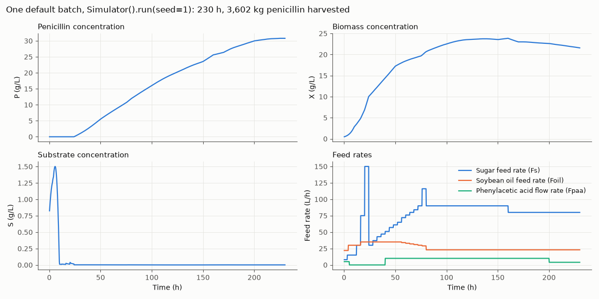
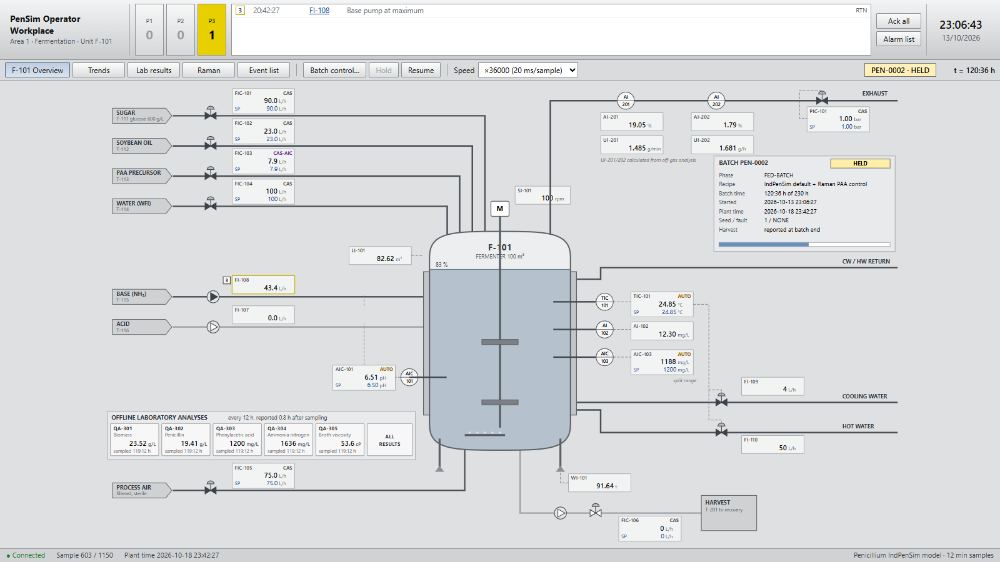

# Penicillium: a Python implementation of the IndPenSim penicillin fermentation simulator

[](https://pypi.org/project/penicillium/) [](https://pypi.org/project/penicillium/) [](https://github.com/francesco-sartori/Penicillium/actions/workflows/ci.yml) [](https://penicillium.readthedocs.io/en/latest/) [](https://doi.org/10.5281/zenodo.23773130) [](https://github.com/francesco-sartori/Penicillium/blob/main/LICENSE) [](https://pepy.tech/project/penicillium)

Penicillium is a maintained Python implementation of IndPenSim, the industrial-scale (100 m³) fed-batch penicillin
fermentation simulator of Goldrick et al. (2015, 2019). IndPenSim is a benchmark process for bioprocess monitoring,
soft sensors, fault detection and control.

- **Matches the published data.** Compared with the 100-batch data set of Goldrick et al. (2019; Mendeley Data,
  CC BY 4.0), no significant difference was detected in the yield distributions of recipe-driven,
  operator-controlled and faulty batches (KS p = 0.31-0.93; the tests have low power)
  ([validation](https://penicillium.readthedocs.io/en/latest/validation/)).
- **Follows IndPenSim V2.01.** Checked line by line against IndPenSim V2.01; 14 of 15 batches run in V2.01 (under
  GNU Octave) replayed within 0.1 % on yield ([differences and quirks](https://penicillium.readthedocs.io/en/latest/quirks/)).
- **Fast.** 0.6 s per 230 h batch; about 380 batches per minute in parallel on an Intel Core i7-7700HQ
  ([benchmarks](https://penicillium.readthedocs.io/en/latest/benchmarks/)).
- **Installs anywhere.** `pip install`, Python 3.10 or later, no compiler, no MATLAB. Tested on Linux, macOS and
  Windows with Python 3.10 to 3.14; random inputs bit-identical and trajectories within about 1e-4 across them.
- **Open licence.** MIT, with the parts derived from IndPenSim also under IndPenSim's BSD 3-Clause licence
  ([licensing](https://penicillium.readthedocs.io/en/latest/licensing/)).
- **Ready for ML and control.** Labelled campaigns, Gymnasium environments, Minari datasets and a differentiable
  JAX model.
- **Limits stated.** Known limitations, such as fixed fault windows, are listed in the
  [documentation](https://penicillium.readthedocs.io/en/latest/#limitations-at-a-glance).



*One default batch, `Simulator().run(seed=1)` ([script](https://github.com/francesco-sartori/Penicillium/blob/main/docs/scripts/readme_figure.py)).*

> Status: alpha (0.1.0a1). The API may still change.

## Install

```bash
pip install penicillium
pip install "penicillium[fast]"   # with the Numba backend (recommended, about 20 times faster)
```

Other extras: `gym`, `minari`, `jax`, `dcs`, `parquet`, `notebooks`, `docs`
([installation](https://penicillium.readthedocs.io/en/latest/installation/)).

## Examples

```python
from penicillium import Simulator

result = Simulator().run(seed=1)  # one 230 h batch, 1150 samples of 12 min
print(result.total_yield)  # harvested penicillin, kg
df = result.to_pandas()  # 55 channels, indexed by time in hours
```

A labelled fault-detection data set, split by batch:

```python
from penicillium import scenarios

if __name__ == "__main__":  # campaigns run in worker processes
    camp = scenarios.fault_campaign(n_normal=20, n_per_fault=5, seed=0)  # 55 batches, 7 fault types
    data = camp.online()  # one row per 12 min sample: labels and 21 online measurements
    train_ids, test_ids = camp.split(test_fraction=0.3)  # by batch, stratified by fault
    train = data[data.batch_id.isin(train_ids)]  # per-sample label: train.fault_active
```

## Operator console

`penicillium dcs` (extra `dcs`) runs one batch in real time in the browser on a DCS-style operator display, for
teaching and operator training ([operator console](https://penicillium.readthedocs.io/en/latest/dcs/)).



## Learn more

| | |
|---|---|
| [Tutorials](https://penicillium.readthedocs.io/en/latest/tutorials/) | Nine notebooks, from a first batch to fault detection, soft sensors, reinforcement learning and the JAX model |
| [User guide](https://penicillium.readthedocs.io/en/latest/) | The process, the model, every option, variables and units, FAQ |
| [Validation](https://penicillium.readthedocs.io/en/latest/validation/) | What is checked against IndPenSim and the published data, and the results |
| [Case studies](https://github.com/francesco-sartori/Penicillium/tree/main/notebooks) | Replications of Goldrick et al. (2015, 2019), a comparison with the published 100-batch data, a statistical check of the noise model |

## Contributing

See [CONTRIBUTING.md](https://github.com/francesco-sartori/Penicillium/blob/main/CONTRIBUTING.md) (development
install, tests, style). Start with issues labelled
[good first issue](https://github.com/francesco-sartori/Penicillium/issues?q=is%3Aissue+is%3Aopen+label%3A%22good+first+issue%22).
Report bugs as [issues](https://github.com/francesco-sartori/Penicillium/issues) with the version, a minimal
script with its seed, and the output.

## Citation

If you use Penicillium, cite IndPenSim and this package ([CITATION.cff](https://github.com/francesco-sartori/Penicillium/blob/main/CITATION.cff); see [citing](https://penicillium.readthedocs.io/en/latest/citing/)):

- S. Goldrick, A. Ştefan, D. Lovett, G. Montague, B. Lennox. *The development of an industrial-scale fed-batch
  fermentation simulation.* Journal of Biotechnology 193 (2015) 70-82. doi:10.1016/j.jbiotec.2014.10.029
- S. Goldrick, C. A. Duran-Villalobos, K. Jankauskas, D. Lovett, S. S. Farid, B. Lennox. *Modern day monitoring and
  control challenges outlined on an industrial-scale benchmark fermentation process.* Computers and Chemical
  Engineering 130 (2019) 106471. doi:10.1016/j.compchemeng.2019.05.037
- F. Sartori. *Penicillium: a validated, pip-installable Python implementation of the IndPenSim penicillin
  fermentation simulator.* Software, Zenodo. doi:10.5281/zenodo.23773130 (all versions; each release also has its
  own DOI)

<!-- TODO: Acknowledgements section, pending confirmed text from the author. -->

## Licence

Penicillium is released under the MIT License. Its process model, controllers, recipes, fault profiles and
reference Raman spectrum derive from IndPenSim, Copyright (c) 2016, Stephen Goldrick, distributed under the BSD
3-Clause License; that notice applies to those parts too. It is not endorsed by IndPenSim's authors or by
University College London. Full texts are in [LICENSE](https://github.com/francesco-sartori/Penicillium/blob/main/LICENSE)
and [NOTICE](https://github.com/francesco-sartori/Penicillium/blob/main/NOTICE).
