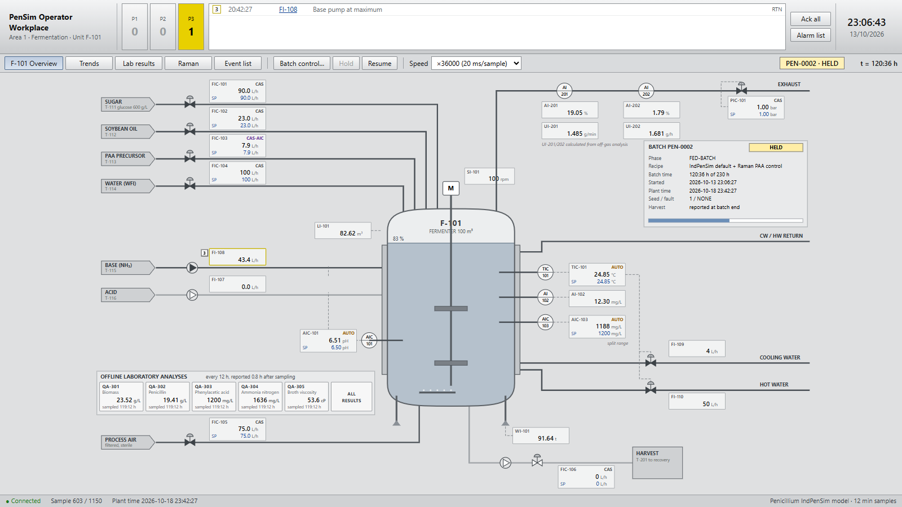
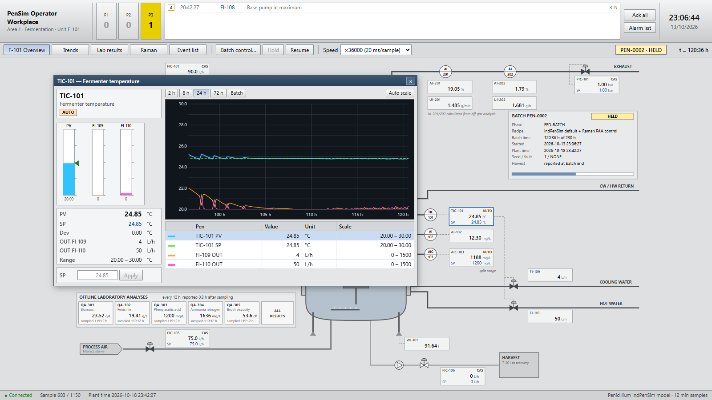
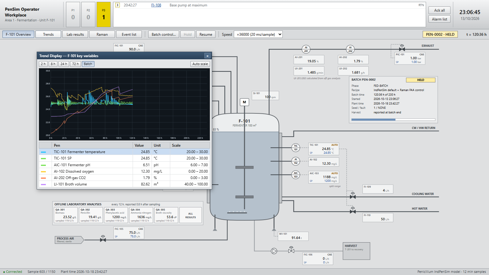
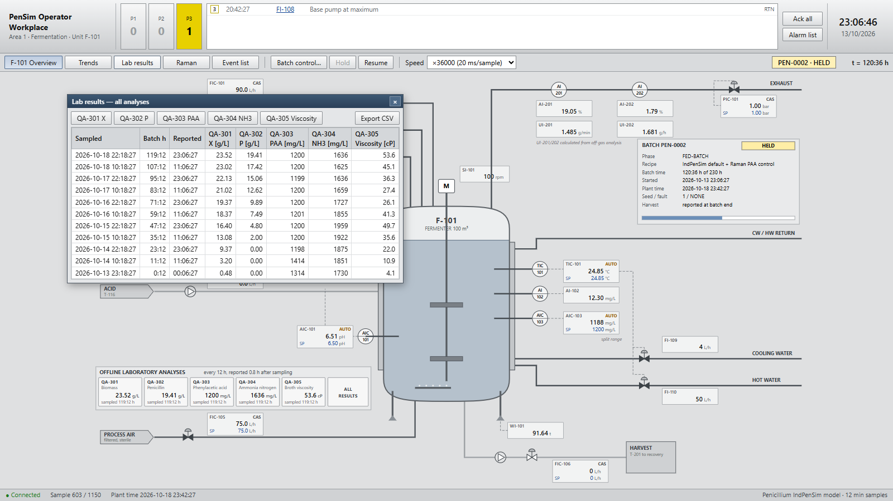
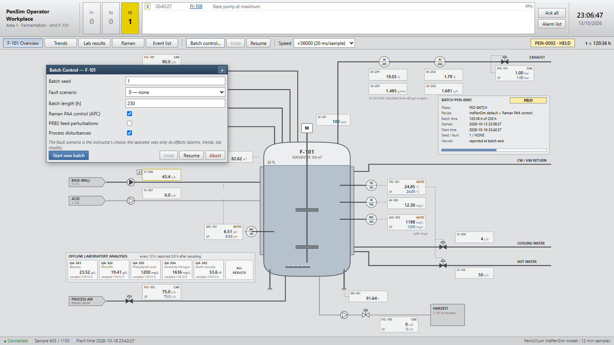

# Operator console (DCS)

`penicillium dcs` runs one batch in real time in the browser, on a process display laid out like a DCS operator
workplace: grey process graphic, colour only for abnormal states, faceplates, alarm band, event journal. It is
meant for teaching, operator training and demonstrations: the instructor picks the batch seed and the fault; the
operator sees only what a control room would see.

```bash
pip install -e ".[dcs]"          # FastAPI, uvicorn, Numba
penicillium dcs                # http://localhost:8050/, opens a browser
penicillium dcs --port 9000 --no-browser
```

Every browser connected to the server sees the same batch, so an instructor and trainees can watch one console
each.

!!! note "No Node.js needed to run the console"
    The web front end ships prebuilt inside the package and is served by the Python web server of the `dcs`
    extra. Node.js is needed only to develop the console, that is, to modify and rebuild the front end
    ([Architecture](#architecture)).

<figure markdown="span">
  { loading=lazy }
  <figcaption>The F-101 overview, 120 h into a nominal batch with Raman PAA control (held). The alarm band shows one priority-3 alarm: the base pump at maximum.</figcaption>
</figure>

## What is on the display

| Area | Contents |
|---|---|
| Application bar | Alarm band (count per priority, blinking while unacknowledged), the four most important alarms, *Ack all*, clock |
| Toolbar | Trends, lab results, Raman spectrum, event list, batch control, hold/resume, speed (real time to ×36000) |
| Process graphic | Fermenter F-101 with level, feeds, acid/base dosing, aeration, off-gas, jacket utilities, probes, draw-off |
| Batch panel | Batch ID, state, phase, batch and plant time, seed and fault, harvest (at batch end), progress |
| Lab panel | One button per offline analysis with the latest result and its sampling time, and *All results* |

Value blocks show the tag, the measured value and, for controllers, the setpoint and mode. Click any block or
instrument bubble to open its faceplate.

### Faceplates and trends

A faceplate shows PV, SP, deviation and outputs as numbers and bars, the active alarms of the object, and a trend of
PV, SP and outputs (each pen with its own scale; click a pen to show its scale; *Auto scale*; ranges from 2 h to the
whole batch; hover for a cursor readout). Several faceplates can be open at once; drag them by the title bar.

<figure markdown="span">
  { loading=lazy }
  <figcaption>Faceplate of the temperature loop TIC-101: PV, SP and the split-range outputs to cooling (FI-109) and hot water (FI-110), with a 24 h trend.</figcaption>
</figure>

<figure markdown="span">
  { loading=lazy }
  <figcaption>The trend display of the key F-101 variables over the whole batch, each pen with its own scale.</figcaption>
</figure>

| Tag | Object | Setpoint | Outputs |
|---|---|---|---|
| FIC-101 … FIC-106, PIC-101 | sugar, oil, PAA, water, aeration, draw-off, back pressure | batch recipe (CAS) or operator (AUTO) | the flow / pressure itself |
| TIC-101 | temperature, °C | operator | FI-109 cooling, FI-110 heating (split range) |
| AIC-101 | pH | operator | FI-108 base, FI-107 acid (split range) |
| AIC-103 | PAA from Raman (PLS soft sensor) | 1200 mg/L, fixed (with Raman PAA control only) | FIC-103 |
| AI-102, AI-201/202, UI-201/202, LI-101, WI-101, SI-101 | DO, off-gas O2/CO2, OUR/CER, volume, weight, agitator | — | — |

Recipe loops start in **CAS** (setpoint from the IndPenSim recipe). Typing a setpoint switches the loop to **AUTO**
(operator setpoint); switching back to CAS returns it to the recipe. Switching CAS → AUTO is bumpless. With PRBS on,
the sugar and PAA feeds are driven by the perturbation sequence after 95 h (mode **PRBS**); with Raman PAA control,
the PAA feed follows AIC-103 after 10 h (mode **CAS-AIC**). In those modes the SP shown is the applied value.

What the console shows differs from the simulator's channels in three ways:

- **Units for operators:** temperature in °C, volume in m³, weight in t, off-gas O2 in %, draw-off as a positive flow.
- **Sensor faults are visible as the sensor sees them.** With faults 7 and 8 the TIC-101 / AIC-101 PV is the drifting
  measurement the controller acts on, so the loop looks healthy while the broth drifts away. Only the lab results
  (and the batch outcome) give it away, as in a real plant.
- **Penicillin is not an online measurement.** The titre comes from the lab (QA-302); the harvest is reported at
  the end of the batch.

### Alarms

Limit alarms with priorities 1 (urgent, red), 2 (high, orange) and 3 (medium, yellow), each with a deadband:

| Object | Alarms |
|---|---|
| TIC-101 | high (SP + 2.2 K), high high (SP + 3 K), low (SP − 1.5 K) |
| AIC-101 | high / low (SP ± 0.2) |
| AI-102 | DO low (6 mg/L), low low (3 mg/L) |
| LI-101 | volume high (90 m³), high high (95 m³), low (50 m³) |
| AI-202 | off-gas CO2 high (2.5 %) |
| FI-108 | base pump at maximum |
| AIC-103 | PAA high (2000 mg/L) |
| PIC-101, FIC-105, FIC-101, FIC-103 | PV/SP deviation |

IndPenSim's temperature loop is loose (1–2 K excursions are normal), so the temperature limits sit above that; a
nominal batch raises only a few alarms (typically the base pump saturating around 21 h). An alarm stays in the list until it has returned to normal *and* been
acknowledged; returned, unacknowledged alarms are shown hollow. Every alarm, return, acknowledgement, operator
action, lab report and batch event goes into the event list.

### Offline lab results

Biomass (QA-301), penicillin (QA-302), PAA (QA-303), ammonia (QA-304) and viscosity (QA-305) are sampled at 1 h,
every 12 h and at the end of the batch, and reported 0.8 h after sampling (`SimulationConfig.offline_interval_h`
and `offline_delay_steps`). Each button opens a trend of the results at their sampling times and a table; *All
results* shows every analysis per sample and exports CSV.

<figure markdown="span">
  { loading=lazy }
  <figcaption><em>All results</em>: every analysis per sample, with sampling and reporting times.</figcaption>
</figure>

## Batch control

*Batch control…* starts a new batch (seed, fault 0–8, batch length, Raman PAA control, PRBS, disturbances) and holds,
resumes or aborts the current one. The speed selector changes the pace at any time: real time is one 12-minute
sample every 12 minutes, ×3600 one sample every 0.2 s, ×36000 a 230 h batch in about 25 s.

<figure markdown="span">
  { loading=lazy }
  <figcaption>The batch control dialog: seed, fault scenario, batch length and the process options for the next batch.</figcaption>
</figure>

## Architecture

- `penicillium.dcs.session.BatchSession`: the plant logic without any web code (loops, modes, setpoints,
  alarms, events, lab results). It can be scripted and tested on its own:

  ```python
  from penicillium.dcs import BatchSession, BatchState

  s = BatchSession()
  s.start(seed=1, fault=5)  # coolant-flow fault
  while s.state is BatchState.RUNNING:
      if s.time_h >= 50 and s.modes["Fs"] == "CAS":
          s.set_sp("Fs", 100.0)  # operator setpoint (L/h): the loop switches to AUTO
      s.step()
  print(s.total_yield, len(s.events))  # 3900 kg, 37 events (3598 kg and 29 events without the operator action)
  ```

  **Worked example: scripting an operator** (its first half, generating a paired data set, is in
  [Command line](cli.md#worked-example-a-paired-fault-data-set)). An operator takes the sugar feed out of CAS at 50 h and raises it
  to 100 L/h in a batch with the coolant-flow fault. The action raises the harvest from 3598 to 3900 kg, and the
  event list records it alongside the alarms, lab reports and batch events. The same session, run in the browser,
  lets trainees try the action themselves and compare their result with the scripted one.

- `penicillium.dcs.server`: FastAPI app; steps the session at the chosen speed and streams samples, alarms and
  events over a WebSocket (`/ws`); commands come back on the same socket. The protocol is in the module docstring.
- `webapp/`: the React front end (Vite), the only part that needs Node.js, and only to develop it. `npm run build` writes it into `src/penicillium/dcs/static`, which the
  server serves. For front-end work run `penicillium dcs --no-browser` and `npm run dev` (port 5173, WebSocket
  proxied to 8050).
