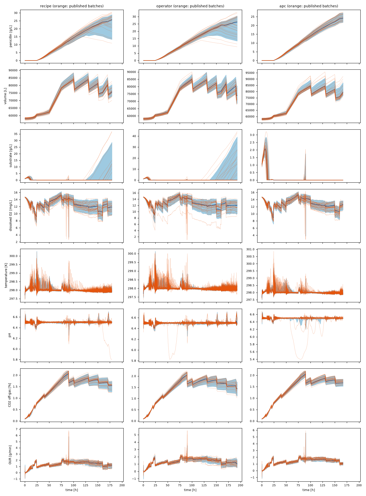

# Validation against the published IndPenSim 100-batch data set

Generated by `validation/compare_100_batches.py` with Penicillium 0.1.0.dev0: 300 simulated batches (3 replicates of the published campaign's structure) in 67 s. Data: Goldrick (2019), [doi:10.17632/pdnjz7zz5x.1](https://doi.org/10.17632/pdnjz7zz5x.1), CC BY 4.0.

Every simulated batch copies a published batch's control strategy, length and fault (the fault types are read from the inputs, see [below](#fault-types-of-the-published-faulty-batches)). Random streams differ from MATLAB's, so distributions are compared, not individual batches.

## Yields

| strategy | published mean ± sd [kg] | simulated mean ± sd [kg] | KS p-value | published final P [g/L] | simulated final P [g/L] | KS p-value |
|---|---|---|---|---|---|---|
| recipe (n=30 / 90) | 2913 ± 768 | 2868 ± 840 | 0.93 | 24.3 ± 8.7 | 23.7 ± 7.9 | 0.87 |
| operator (n=30 / 90) | 2833 ± 680 | 2822 ± 848 | 0.31 | 21.5 ± 8.0 | 22.6 ± 8.0 | 0.54 |
| apc (n=30 / 90) | 3484 ± 308 | 3356 ± 324 | 0.10 | 29.4 ± 2.7 | 29.1 ± 2.2 | 0.04 |
| fault (n=10 / 30) | 2600 ± 1200 | 2061 ± 1099 | 0.63 | 14.4 ± 11.0 | 16.5 ± 10.2 | 0.48 |

The two-sample Kolmogorov-Smirnov (KS) test compares the whole distributions (location, spread and shape) and needs no assumption of normality. A p-value above 0.05 means that **no significant difference was detected** at the 5 % level, not that the distributions are equal: with 30 published batches per strategy (10 with faults) the test has low power, as the next table shows.

### Size of the differences

Supplementary to the KS test: the mean yield difference (simulated minus published) with its 95 % Welch interval, and the power of the KS test at these sample sizes, computed from the published summary statistics (normal yields with the published standard deviation): the probability of detecting a shift of the mean by 5 % of the published mean, and the shift it detects with 80 % probability.

| strategy | mean difference [kg] | 95 % Welch interval [kg] | KS power, 5 % shift | shift detected with 80 % power [kg] |
|---|---|---|---|---|
| recipe | -45 (-1.5 %) | -377 to +288 | 0.12 | 576 |
| operator | -11 (-0.4 %) | -317 to +295 | 0.13 | 510 |
| apc | -128 (-3.7 %) | -260 to +4 | 0.62 | 231 |
| fault | -539 (-20.7 %) | -1458 to +379 | 0.04 | 1559 |

## Trajectory envelopes

Coverage: share of published samples inside the simulated 5-95 % band at the same time (up to the shortest batch of each strategy); about 0.9 is expected when the two distributions agree. Median gap: mean absolute difference between the published and simulated median trajectories, relative to the channel's 99th percentile. The samples of one batch are strongly correlated in time, so with 30 published batches per strategy (10 with faults) the coverage of a band varies by several percentage points by chance. Every channel, with the number of samples inside the band and compared, is in the [coverage appendix](validation_coverage.md); some channels not shown here have lower coverage, the lowest being the vessel weight `Wt` in the faulty batches (see the appendix for its value).

| channel | recipe coverage | operator coverage | apc coverage | fault coverage | recipe median gap | operator median gap | apc median gap | fault median gap |
|---|---|---|---|---|---|---|---|---|
| P | 0.88 | 0.87 | 0.93 | 0.81 | 0.004 | 0.004 | 0.006 | 0.054 |
| V | 0.83 | 0.91 | 0.83 | 0.80 | 0.001 | 0.006 | 0.002 | 0.006 |
| S | 0.91 | 0.85 | 0.91 | 0.86 | 0.000 | 0.003 | 0.001 | 0.067 |
| DO2 | 0.91 | 0.91 | 0.95 | 0.92 | 0.014 | 0.007 | 0.012 | 0.014 |
| T | 0.89 | 0.88 | 0.89 | 0.80 | 0.000 | 0.000 | 0.000 | 0.000 |
| pH | 0.90 | 0.91 | 0.88 | 0.85 | 0.000 | 0.000 | 0.000 | 0.001 |
| CO2outgas | 0.89 | 0.92 | 0.89 | 0.79 | 0.006 | 0.007 | 0.010 | 0.004 |
| OUR | 0.89 | 0.89 | 0.92 | 0.80 | 0.012 | 0.018 | 0.024 | 0.026 |
| Fs | 1.00 | 0.99 | 1.00 | 1.00 | 0.000 | 0.005 | 0.000 | 0.000 |
| Fpaa | 1.00 | 0.99 | 0.93 | 1.00 | 0.000 | 0.000 | 0.013 | 0.000 |
| Fb | 0.92 | 0.90 | 0.89 | 0.84 | 0.013 | 0.024 | 0.015 | 0.040 |
| Fc | 0.91 | 0.89 | 0.91 | 0.84 | 0.016 | 0.020 | 0.011 | 0.034 |

## Fault types of the published faulty batches

The published data set flags the faulty samples (`Fault_ref`) but does not name the fault type, so the type is read from the inputs. Each IndPenSim process fault holds one input at a fixed value over fixed sample windows ([Faults](faults.md#faults)), for example the aeration at 20 m³/min over samples 100-120 (20-24 h). For each of batches 91 to 100, exactly one of these signatures matches on every sample of its windows, and none of the other process faults matches on any sample. As an independent check, the samples with `Fault_ref` = 1 coincide with the window schedule of the assigned fault. Sensor drifts leave no signature in the inputs and could not be identified this way, but none of the ten batches needs that case.

There is no published label to measure the accuracy of this method against; it rests on the fingerprint of each fault (the input involved, its value and the start of its windows), and all ten batches are taken as correctly identified.

| batch | assigned fault | signal | samples matching, all windows | samples matching another fault | `Fault_ref` matches the schedule |
|---|---|---|---|---|---|
| 91 | SUBSTRATE_FEED | `Fs` = 2 | 203 of 203 | 0 | yes |
| 92 | BASE_FLOW | `Fb` = 5 | 122 of 122 | 0 | yes |
| 93 | COOLANT_FLOW | `Fc` = 2 | 101 of 101 | 0 | yes |
| 94 | AERATION | `Fg` = 20 | 72 of 72 | 0 | yes |
| 95 | SUBSTRATE_FEED | `Fs` = 2 | 188 of 188 | 0 | yes |
| 96 | COOLANT_FLOW | `Fc` = 2 | 101 of 101 | 0 | yes |
| 97 | SUBSTRATE_FEED | `Fs` = 2 | 203 of 203 | 0 | yes |
| 98 | BASE_FLOW | `Fb` = 5 | 122 of 122 | 0 | yes |
| 99 | AERATION | `Fg` = 20 | 72 of 72 | 0 | yes |
| 100 | AERATION | `Fg` = 20 | 72 of 72 | 0 | yes |

In total: 3 SUBSTRATE_FEED, 3 AERATION, 2 BASE_FLOW, 2 COOLANT_FLOW.
