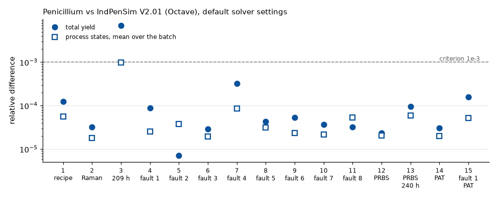
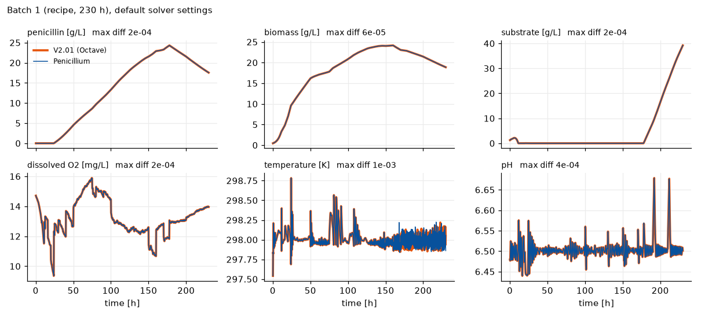
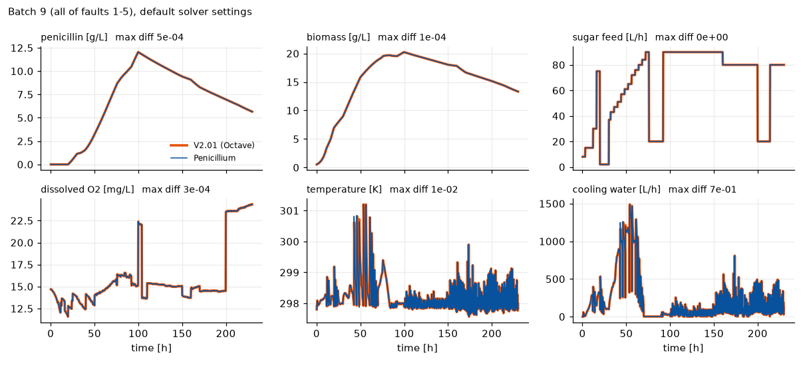
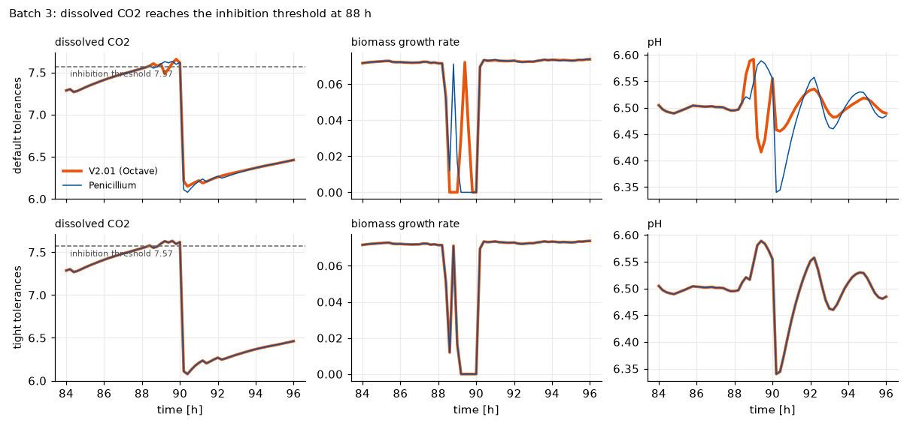
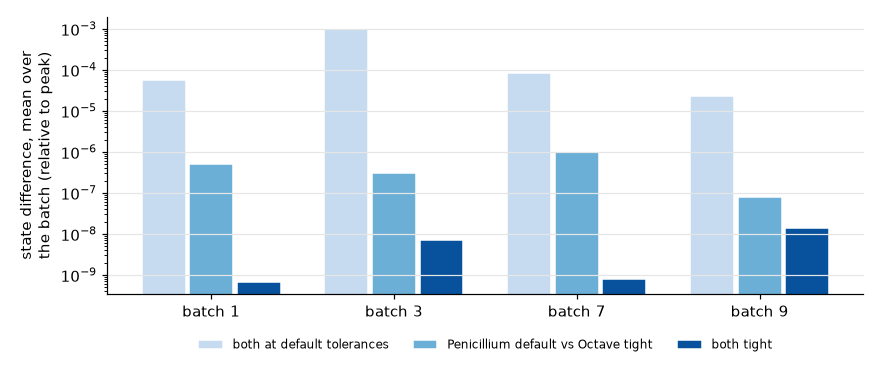

# Batch-by-batch comparison with IndPenSim V2.01

We ran the original IndPenSim V2.01 code under GNU Octave, saved every random input of 15 batches, and gave the
same inputs to Penicillium. **14 of the 15 batches agree within 0.1 % on total yield and within 1e-4 on the
process states** (mean over the batch, relative to each variable's peak). In the 15th batch, dissolved CO2 reaches
a steep inhibition threshold at 88 h; there the two runs take different paths, and the yields end up 0.7 % apart.
Run again with tight solver tolerances, that batch agrees to 2e-8 on yield and never differs by more than 1e-3 on
any state: the difference was numerical.

So, apart from small numerical differences between the ODE solvers, Penicillium gives the same batches as
IndPenSim V2.01. The reference is V2.01 run under Octave, not MATLAB; see [Limitations](#limitations).

## Method

**Reference.** IndPenSim V2.01 (MATLAB File Exchange 49041, version 2.0.1, 9 July 2019), run in GNU Octave 11.3.0
(official Windows installer, OpenBLAS, `signal` package 1.4.7) on Windows 10. The model (`indpensim_ode.m`), the
controllers (`fctrl_indpensim.m`, `PIDSimple3.m`), the main loop (`indpensim.m`), the Raman and PLS steps
(`Raman_Sim.m`, `Substrate_prediction.m`) and `Parameter_list.m` are V2.01's own files. The driver,
`validation/octave/run_indpensim_v201.m`, copies them and makes the changes Octave needs:

| Change | Why |
|---|---|
| `ode15s('indpensim_ode', tspan, x00, [], u00, p)` becomes `ode15s(@(t, y) indpensim_ode(t, y, [], u00, p), tspan, x00, odeset('InitialSlope', f(t0, x00)))` | Octave does not pass extra arguments in MATLAB's old `(t, y, flag, p1, p2)` form. Octave's `ode15s` (SUNDIALS IDA) starts from a zero slope unless given one, and then fails at t = 0; MATLAB's starts from f(t0, y0), which is what is passed |
| `smooth.m` added | MATLAB's `smooth` is in the Curve Fitting Toolbox, which Octave lacks. The stand-in is a centred moving average whose window shrinks at the ends, as MATLAB documents. It only shapes the noise on Raman spectra |
| Random setup of `indpensim_run.m` repeated with a fixed `Random_seed_ref` | V2.01 draws `Random_seed_ref = ceil(rand*1000)` from an unseeded generator, so its batches cannot be re-run. The driver repeats the setup block unchanged with `Random_seed_ref` given, and draws the variable batch length after `rng(Random_seed_ref)` |

**Replay.** Each batch's inputs (initial state, `mu_x`, `mu_p`, `alpha_kla`, `PAA_c`, `N_conc_paa`, the eight
disturbance sequences, batch length, fault, Raman and PRBS flags) are saved in `validation/octave/data/case_NN.mat`
and read by `BatchParameters.from_matlab`. The PRBS steps of batches 12 and 13 (V2.01 draws them with
`rng('shuffle')`) are recovered from the recorded sugar and PAA feeds and replayed in the same order. Raman noise is
off in Penicillium (`raman_noise=False`).

**Batches.** Recipe control with fixed and variable length, each of the eight faults, two operator-controlled
(PRBS) batches, one batch recording spectra (`Raman_spec = 1`) and two under PAT control (`Raman_spec = 2`):

| Batch | Batch_no | Random_seed_ref | Control | Length | T [h] | Fault | Raman_spec |
|---|---|---|---|---|---|---|---|
| 1 | 1 | 101 | recipe | fixed | 230 | 0 (none) | 0 |
| 2 | 2 | 202 | recipe | fixed | 230 | 0 (none) | 1 |
| 3 | 3 | 303 | recipe | variable | 209 | 0 (none) | 0 |
| 4 | 4 | 404 | recipe | fixed | 230 | 1 (aeration) | 0 |
| 5 | 5 | 505 | recipe | fixed | 230 | 2 (pressure) | 0 |
| 6 | 6 | 606 | recipe | fixed | 230 | 3 (substrate feed) | 0 |
| 7 | 7 | 707 | recipe | fixed | 230 | 4 (base flow) | 0 |
| 8 | 8 | 808 | recipe | fixed | 230 | 5 (coolant flow) | 0 |
| 9 | 9 | 909 | recipe | fixed | 230 | 6 (all of 1-5) | 0 |
| 10 | 10 | 110 | recipe | fixed | 230 | 7 (temperature sensor) | 0 |
| 11 | 11 | 211 | recipe | fixed | 230 | 8 (pH sensor) | 0 |
| 12 | 12 | 312 | operator (PRBS) | fixed | 230 | 0 (none) | 0 |
| 13 | 13 | 413 | operator (PRBS) | variable | 240 | 0 (none) | 0 |
| 14 | 14 | 514 | recipe | fixed | 230 | 0 (none) | 2 |
| 15 | 15 | 615 | recipe | fixed | 230 | 1 (aeration) | 2 |

**Criterion.** A batch agrees if its total yield is within 0.1 % and the process states (S, DO2, O2, P, V, Wt,
pH, T, viscosity, biomass regions, X, CO2 off-gas, dissolved CO2, PAA, NH3) differ on average by less than 1e-3 of
each variable's peak. Penicillium runs with its defaults (LSODA, rtol 1e-5); V2.01 with its own (`ode15s`,
RelTol 1e-3, AbsTol 1e-6).

## Results



| Batch | Type | Yield V2.01 [kg] | Yield Penicillium [kg] | Yield diff | States, mean diff | States, worst diff | Samples with a state diff > 1e-3 | Penicillium [s] | Octave [s] |
|---|---|---|---|---|---|---|---|---|---|
| 1 | recipe, 230 h | 2275.8 | 2275.5 | 1.2e-04 | 5.6e-05 | 7.0e-03 | 219 of 1150 | 1.0 | 900 |
| 2 | recipe, 230 h, Raman | 2033.5 | 2033.6 | 3.3e-05 | 1.8e-05 | 8.2e-04 | 0 of 1150 | 0.7 | 2548 |
| 3 | recipe, 209 h | 2091.3 | 2076.6 | 7.0e-03 | 9.8e-04 | 5.9e-01 | 604 of 1045 | 0.6 | 993 |
| 4 | recipe, 230 h, fault 1 | 1317.1 | 1317.2 | 8.9e-05 | 2.6e-05 | 1.4e-03 | 2 of 1150 | 0.6 | 1106 |
| 5 | recipe, 230 h, fault 2 | 3099.2 | 3099.2 | 7.1e-06 | 3.8e-05 | 2.5e-02 | 11 of 1150 | 0.8 | 978 |
| 6 | recipe, 230 h, fault 3 | 567.4 | 567.4 | 2.9e-05 | 1.9e-05 | 5.3e-04 | 0 of 1150 | 0.6 | 1055 |
| 7 | recipe, 230 h, fault 4 | 2331.9 | 2332.6 | 3.3e-04 | 8.5e-05 | 6.2e-03 | 75 of 1150 | 0.6 | 1064 |
| 8 | recipe, 230 h, fault 5 | 3817.9 | 3818.1 | 4.3e-05 | 3.2e-05 | 3.8e-03 | 19 of 1150 | 0.7 | 848 |
| 9 | recipe, 230 h, fault 6 | 815.5 | 815.5 | 5.4e-05 | 2.3e-05 | 9.7e-03 | 5 of 1150 | 0.6 | 1007 |
| 10 | recipe, 230 h, fault 7 | 3704.3 | 3704.4 | 3.7e-05 | 2.2e-05 | 8.7e-04 | 0 of 1150 | 0.7 | 1005 |
| 11 | recipe, 230 h, fault 8 | 4040.6 | 4040.7 | 3.2e-05 | 5.4e-05 | 5.0e-03 | 186 of 1150 | 0.7 | 719 |
| 12 | PRBS, 230 h | 2310.7 | 2310.6 | 2.4e-05 | 2.0e-05 | 5.6e-03 | 1 of 1150 | 0.7 | 938 |
| 13 | PRBS, 240 h | 1777.0 | 1777.2 | 9.6e-05 | 5.9e-05 | 6.2e-03 | 225 of 1200 | 0.6 | 956 |
| 14 | recipe, 230 h, PAT | 3562.7 | 3562.9 | 3.1e-05 | 2.0e-05 | 5.2e-04 | 0 of 1150 | 1.8 | 2173 |
| 15 | recipe, 230 h, fault 1, PAT | 2978.3 | 2977.8 | 1.6e-04 | 5.2e-05 | 4.9e-03 | 115 of 1150 | 1.7 | 2157 |

Batch 1, with every sample of both runs:



Faults are reproduced sample for sample. Batch 9 has all of faults 1-5 (aeration, pressure, sugar feed, base flow,
coolant flow):



**PAT control.** In batches 14 and 15 a PID loop feeds PAA to 1200 mg/L from 10 h on. In V2.01, as in
Penicillium, the loop acts on the true PAA concentration; the PAA predicted from the Raman spectra enters only the
loop's derivative term, whose gain is zero (`fctrl_indpensim.m`). The process therefore does not depend on the
random noise of the spectra or on the PLS model (Penicillium uses its own, see [licensing.md](licensing.md)), and
the batches can be replayed like the others. The spectra themselves and the PLS predictions are not compared,
because their noise is drawn by different generators.

## Where the differences come from

The model has on/off switches, and a difference of solver-tolerance size can flip a switch at one sample in one run
and not in the other.

- **Heating and cooling water.** The temperature controller cools while `298 K - T <= 0.05 K` and heats otherwise.
  In batch 1 at 167.8 h the temperatures differ by 0.0009 K (297.9499 K and 297.9508 K): the error is 0.0501 K in
  Penicillium and 0.0492 K in V2.01, so one run heats and the other cools. From then on both runs cycle between
  heating and cooling, out of phase. This is why Fc, Fh and the heat Q differ by up to 70 % of their peak at single
  samples (batch 9 above). The temperature itself differs at those samples by up to 0.4 K in batch 1 and up to 3 K
  in batch 9, where the coolant fault drives large swings, and the other states barely change. Such flips cause
  the samples above 1e-3 in the results table: a few samples of DO2, T or dissolved CO2 in most batches; a small
  lasting offset in dissolved CO2 (which depends on temperature) after the flip in batches 1, 11, 13 and 15; and
  in batch 7, whose base-flow fault upsets the pH loop, about 30 samples of pH and DO2 as well.
- **Dissolved CO2 inhibition.** Growth is multiplied by `0.5 (1 + tanh(7570 - 1000 CO2_d))`, which drops from 1
  to 0 within about 0.001 g/L of dissolved CO2 ([quirks.md](quirks.md), section 4). This is batch 3.

### Batch 3

Up to 88.2 h batch 3 agrees as closely as the others. At 88.4 h dissolved CO2 crosses 7.57 g/L, growth stops,
CO2 falls, growth restarts, and for about ten samples the batch chatters on the threshold. At default tolerances
the two runs chatter on different samples. The pH controller then adds acid in one run and base in the other,
which leaves a lasting pH and penicillin offset: 0.7 % in final yield. Neither of IndPenSim's state clamps
(states <= 0 set to 0.001, DO2 < 2 set to 1) is involved; both were checked.

With tight tolerances the two runs chatter on the same samples and stay together to the end of the batch (yield
difference 2e-8, no state ever more than 4e-5 of its peak apart). Penicillium at its default settings already
follows this path (yield difference 3e-7 from the tight Octave run). The Octave run at RelTol 1e-3 takes a
different path through the episode: its own yield differs by 0.7 % from its tight run.



### Tight tolerances

To separate the solvers from the equations, batches 1, 3, 7 and 9 were run again with Octave's `ode15s` at
RelTol 1e-8, AbsTol 1e-10 and Penicillium at rtol 1e-10, atol 1e-12:



| Batch | Yield diff: both default | Penicillium default vs Octave tight | both tight | States, mean diff: both default | Penicillium default vs Octave tight | both tight | Samples with a state diff > 1e-3: both default | both tight |
|---|---|---|---|---|---|---|---|---|
| 1 | 1.2e-04 | 4.4e-08 | 3.7e-09 | 5.6e-05 | 4.9e-07 | 6.9e-10 | 219 | 0 of 1150 |
| 3 | 7.0e-03 | 3.3e-07 | 1.9e-08 | 9.8e-04 | 3.1e-07 | 7.1e-09 | 604 | 0 of 1045 |
| 7 | 3.3e-04 | 5.2e-06 | 4.8e-09 | 8.5e-05 | 1.0e-06 | 8.1e-10 | 75 | 0 of 1150 |
| 9 | 5.4e-05 | 2.4e-07 | 6.7e-08 | 2.3e-05 | 8.2e-08 | 1.4e-08 | 5 | 0 of 1150 |

With both solvers tight, the four batches agree to between 4e-9 and 7e-8 on yield, 1e-8 or better on the states
on average, and no state ever differs by 1e-3 of its peak, including in batch 3. So the two implementations solve
the same equations with the same controller logic. At default settings the differences between Penicillium and
V2.01 have the same size as the difference between V2.01 at RelTol 1e-3 and V2.01 at RelTol 1e-8 (for batch 3:
0.70 % and 0.71 % in yield), while Penicillium at its defaults stays within about 1e-6 of the tight solution on
average (single samples at switches up to 4e-3, in batch 7).

## Not compared

- **Raman spectra and PLS predictions** of batches 2, 14 and 15: their random baseline noise is drawn by
  different generators. They do not affect the process (see PAT control above).
- **Off-line lab measurements**, which are delayed samples of the compared states.

## Limitations

This comparison is not fully rigorous. The reference should be IndPenSim run in MATLAB, and it is V2.01 run in
Octave:

- **The two `ode15s` are different solvers.** MATLAB's uses numerical differentiation formulas (NDF) with its own
  step and Jacobian control; Octave's wraps the BDF solver IDA of SUNDIALS. At the default RelTol 1e-3 their
  solutions differ by amounts of the size seen here, so V2.01 in MATLAB will not give exactly the batches above,
  and a batch that reaches a steep switch, like batch 3, may take a different path again. At tight tolerances both
  converge to the solution of the same equations, which is what the tight comparison tests.
- **The Octave changes** above. None changes the equations, the controllers or the main loop.
- **Seeds reproduce the batches in Octave only.** Octave's random generators are not guaranteed to produce
  MATLAB's numbers for the same seed, so `Random_seed_ref` in MATLAB gives other batches. To compare with MATLAB,
  load the saved inputs from `validation/octave/data` into V2.01's setup
  ([below](#replay-the-15-batches-in-penicillium-or-in-matlab)), or capture new ones in MATLAB as shown in
  [Validation](validation.md#batch-by-batch-comparison-with-matlab).
- **Language differences** between MATLAB and Octave in built-in functions (`interp1`, `filter`, `log`) could
  change last digits. This was not tested.

Within these limits the comparison supports the claim that Penicillium reproduces IndPenSim V2.01, with the
remaining differences coming from the ODE solvers.

## Repeat it

1. Download IndPenSim V2.01 from [MATLAB File Exchange](https://www.mathworks.com/matlabcentral/fileexchange/49041-industrial-scale-penicillin-simulationv2)
   and unzip it, and install [GNU Octave](https://octave.org) (11.3.0 was used) with its `signal` package.
2. Run the 15 batches (about 15-40 min each in Octave; batch ids can be split across processes):

    ```bash
    octave-cli --no-gui validation/octave/run_indpensim_v201.m <IndPenSim V2.01 folder> runs/default
    RELTOL=1e-8 ABSTOL=1e-10 octave-cli --no-gui validation/octave/run_indpensim_v201.m <folder> runs/tight 1 3 7 9
    ```

3. Compare, or regenerate this page's figures and tables:

    ```bash
    python validation/octave/compare_octave.py runs/default          # or no argument: the saved batches
    python validation/octave/report.py --collect runs                # copies runs/* to validation/octave/data
    ```

To skip Octave, use the saved batches in `validation/octave/data` (inputs and V2.01's recorded channels). The test
`tests/test_octave_v201.py` replays them.

## Replay the 15 batches in Penicillium or in MATLAB

**Files.** The folder `validation/octave/data` of the repository holds one file per batch, `case_01.mat` to
`case_15.mat` (numbered as in the tables above), in MATLAB's v7 MAT-file format, which MATLAB, Octave and
`scipy.io.loadmat` all read. The subfolder `tight/` holds batches 1, 3, 7 and 9 run again at tight tolerances. Each
file contains:

| Variable | Contents |
|---|---|
| `x0` | Initial state as a structure (`mux`, `mup`, `S`, `DO2`, `X`, `P`, `V`, `Wt`, `CO2outgas`, `O2`, `pH`, `T`, `a0`, `a1`, `a3`, `a4`, `Culture_age`, `PAA`, `NH3`), with pH as pH, as `indpensim_run.m` builds it |
| `alpha_kla`, `PAA_c`, `N_conc_paa` | The three other random batch parameters |
| `distMuP`, `distMuX`, `distcs`, `distcoil`, `distabc`, `distPAA`, `distTcin`, `distO_2in` | The eight disturbance sequences, column vectors of `T/h + 1` values |
| `T`, `Ctrl_flags`, `Random_seed_ref` | Batch length [h], V2.01's control flags (fault, PRBS, Raman mode, ...) and the seed used in Octave |
| `out`, `out_names`, `out_time`, `total_yield_kg` | V2.01's recorded channels (one column per name), their times and the harvested penicillin |

**In Penicillium.** `BatchParameters.from_matlab` reads the random inputs, and the configuration follows from
`Ctrl_flags`:

```python
from scipy.io import loadmat

from penicillium import BatchParameters, Fault, RamanMode, SimulationConfig, Simulator

path = "validation/octave/data/case_04.mat"
m = loadmat(path, squeeze_me=True, struct_as_record=False)
flags = m["Ctrl_flags"]
config = SimulationConfig(
    fault=Fault(int(flags.Faults)),
    raman_mode=RamanMode(int(flags.Raman_spec)),
    raman_noise=False,
    batch_length_h=float(m["T"]),
)
result = Simulator(config=config).run(batch_parameters=BatchParameters.from_matlab(path))
print(result.total_yield, float(m["total_yield_kg"]))  # Penicillium and V2.01 (Octave)
```

The two PRBS batches (12 and 13) also need V2.01's random feed steps, which V2.01 draws with
`rng('shuffle')`; `replay()` in `validation/octave/compare_octave.py` recovers them from the recorded feeds and
replays all 15 batches.

**In MATLAB.** Download IndPenSim V2.01, put its folder on the MATLAB path, and replace the random setup block of
`indpensim_run.m` with the saved inputs:

```matlab
load('case_04.mat')   % x0, alpha_kla, PAA_c, N_conc_paa, dist*, T, Ctrl_flags
h = 0.2;
Batch_time = 0:h:T;
Xinterp.distMuP   = createChannel('distMuP', '', 'h', Batch_time, distMuP);
Xinterp.distMuX   = createChannel('distMuX', '', 'h', Batch_time, distMuX);
Xinterp.distcs    = createChannel('distcs', '', 'h', Batch_time, distcs);
Xinterp.distcoil  = createChannel('distcoil', '', 'h', Batch_time, distcoil);
Xinterp.distabc   = createChannel('distabc', '', 'h', Batch_time, distabc);
Xinterp.distPAA   = createChannel('distPAA', '', 'h', Batch_time, distPAA);
Xinterp.distTcin  = createChannel('distTcin', '', 'h', Batch_time, distTcin);
Xinterp.distO_2in = createChannel('distO_2in', '', 'h', Batch_time, distO_2in);
par = Parameter_list(x0, alpha_kla, N_conc_paa, PAA_c);
Xref = indpensim(@fctrl_indpensim, Xinterp, x0, h, T, 2, par, Ctrl_flags);
```

These are the calls that `validation/octave/run_indpensim_v201.m` makes after its setup block. MATLAB then
runs V2.01's own `ode15s`, which is not Octave's (see [Limitations](#limitations)), so expect differences of
the size seen above at default tolerances. In batches 12 and 13 MATLAB draws new PRBS steps, so those two
batches cannot be reproduced exactly; batches 14 and 15 (PAT control) use V2.01's own `PAA_PLS_model.mat`.

### Initial conditions and batch parameters

Values drawn in Octave from the seeds above (pH as pH; X is split 1/3 : 2/3 into the regions a0 and a1):

| Batch | S [g/L] | DO2 [mg/L] | X [g/L] | V [L] | Wt [kg] | pH | T [K] | PAA [mg/L] | NH3 [mg/L] | O2 [-] | CO2 [%] | mu_x [1/h] | mu_p [1/h] | alpha_kla | PAA_c [mg/L] | N_conc_paa [mg/L] |
|---|---|---|---|---|---|---|---|---|---|---|---|---|---|---|---|---|
| 1 | 1.2182 | 14.942 | 0.4027 | 58768 | 61800 | 6.492 | 296.45 | 1365.9 | 1682.9 | 0.1775 | 0.0377 | 0.4498 | 0.04040 | 85.99 | 527674 | 149318 |
| 2 | 0.9740 | 15.147 | 0.5428 | 58068 | 62870 | 6.686 | 297.04 | 1460.9 | 1753.9 | 0.1848 | 0.0370 | 0.4758 | 0.04091 | 92.20 | 541231 | 148396 |
| 3 | 0.9983 | 14.990 | 0.5011 | 58491 | 62395 | 6.475 | 297.35 | 1485.9 | 1692.3 | 0.2685 | 0.0381 | 0.4001 | 0.04053 | 98.63 | 546030 | 150513 |
| 4 | 0.9969 | 14.632 | 0.6533 | 57469 | 61831 | 6.378 | 296.33 | 1416.1 | 1734.7 | 0.2396 | 0.0379 | 0.4570 | 0.03994 | 83.63 | 538389 | 149995 |
| 5 | 0.9797 | 14.998 | 0.3902 | 58315 | 61958 | 6.534 | 296.90 | 1389.4 | 1707.3 | 0.2402 | 0.0376 | 0.4012 | 0.04383 | 76.37 | 472250 | 151982 |
| 6 | 0.9266 | 15.562 | 0.4264 | 58130 | 61680 | 6.504 | 297.18 | 1406.2 | 1712.0 | 0.2779 | 0.0387 | 0.3931 | 0.03926 | 86.18 | 540610 | 151712 |
| 7 | 0.9122 | 14.532 | 0.3652 | 57760 | 62616 | 6.495 | 297.08 | 1380.6 | 1732.2 | 0.2820 | 0.0375 | 0.3747 | 0.03663 | 81.17 | 515414 | 149085 |
| 8 | 0.9951 | 14.986 | 0.3793 | 56967 | 62769 | 6.466 | 297.05 | 1356.9 | 1731.6 | 0.1991 | 0.0386 | 0.3823 | 0.04241 | 81.17 | 523969 | 148469 |
| 9 | 1.0492 | 15.044 | 0.4618 | 57169 | 60761 | 6.384 | 297.35 | 1453.7 | 1670.0 | 0.2363 | 0.0381 | 0.4297 | 0.04392 | 97.40 | 532102 | 151184 |
| 10 | 0.8979 | 14.284 | 0.3458 | 57487 | 61362 | 6.430 | 297.21 | 1381.9 | 1752.2 | 0.1972 | 0.0392 | 0.4129 | 0.04067 | 97.63 | 549362 | 147947 |
| 11 | 1.0152 | 14.863 | 0.4648 | 57774 | 61807 | 6.511 | 297.37 | 1445.2 | 1736.6 | 0.2503 | 0.0368 | 0.4000 | 0.04566 | 58.94 | 551932 | 146384 |
| 12 | 0.9830 | 15.045 | 0.5440 | 58457 | 61905 | 6.607 | 297.04 | 1422.7 | 1734.5 | 0.1331 | 0.0372 | 0.4095 | 0.04254 | 84.36 | 519588 | 150605 |
| 13 | 0.8840 | 14.752 | 0.3659 | 57938 | 61878 | 6.640 | 296.89 | 1414.9 | 1712.8 | 0.1618 | 0.0379 | 0.4194 | 0.03955 | 55.08 | 519540 | 149000 |
| 14 | 0.9991 | 14.761 | 0.6843 | 58025 | 62200 | 6.411 | 297.32 | 1358.5 | 1781.7 | 0.1744 | 0.0368 | 0.4317 | 0.04212 | 84.87 | 544684 | 151026 |
| 15 | 1.0597 | 14.468 | 0.4182 | 58220 | 61935 | 6.547 | 297.64 | 1345.0 | 1672.6 | 0.1538 | 0.0371 | 0.3697 | 0.03926 | 82.29 | 507011 | 146532 |
